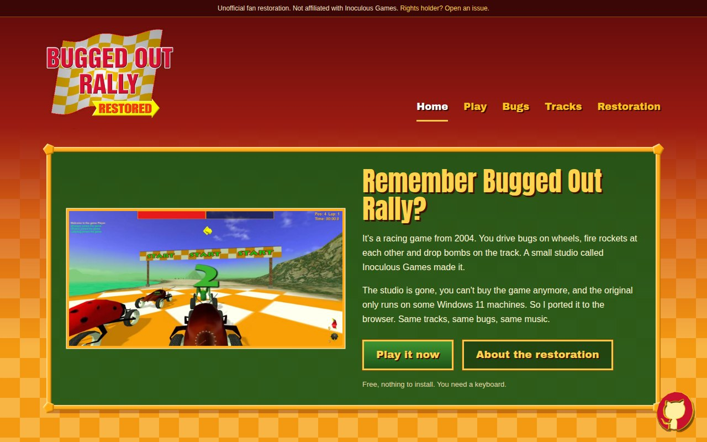

# Bugged Out Rally Restored Web

[](https://github.com/jhm-ciberman/bugged-out-rally-restored-web/actions/workflows/tests.yml)

Source code for the fan website of [Bugged Out Rally Restored](https://buggedoutrally.ciberman.net), a browser port of a racing game from 2004. Built with Laravel 13, Tailwind CSS, and Blade.

> [!NOTE]
> Bugged Out Rally is not my game. It was made in **2004** by **Inoculous Games** and is now **abandonware**. This site is not affiliated with Inoculous Games.



## 👨‍💻 Development

1. Clone the repository and install the dependencies:

```bash
git clone git@github.com:jhm-ciberman/bugged-out-rally-restored-web.git
cd bugged-out-rally-restored-web
composer setup
```

2. Start the development server:

```bash
composer dev
```

Then open [http://localhost:8000](http://localhost:8000) in your browser.

The website uses the following technologies:

- [Laravel 13](https://laravel.com/) as the PHP framework
- [Tailwind CSS 4](https://tailwindcss.com/) for styling
- [Blade](https://laravel.com/docs/13.x/blade) for templating
- [model-viewer](https://modelviewer.dev/) for the 3D bugs
- [Vite](https://vitejs.dev/) as build system

## 🧹 Code Style

To check and fix the code style, run:

```bash
composer pint
```

## 🧪 Testing

To run the tests, run:

```bash
composer test
```

Tests use [Pest](https://pestphp.com/) as the testing framework.

## 📄 Pages

| Route | Description |
|-------|-------------|
| `/` | Main landing page |
| `/play` | The page where the game is embedded |
| `/bugs` | The list of bugs |
| `/bugs/{slug}` | A bug's page, with its 3D model and stats |
| `/tracks` | The list of tracks |
| `/tracks/{slug}` | A track's page, with its video, map and pictures |
| `/restoration` | How the game was ported, side by side pictures and credits |

The numbers and short texts for each bug and track are in `app/Support/Bug.php` and `app/Support/Track.php`.

## 🎮 Game Build

The game itself is not part of this repository. It lives in [bugged-out-rally-restored](https://github.com/jhm-ciberman/bugged-out-rally-restored), and the `/play` page embeds it from `/game-build/index.html`.

To build the latest release of the game into `public/game-build` (gitignored), run:

```bash
php artisan game:build
```

The command does nothing if that release is already built. Pass `--force` to build it again.

## 🔗 Symlinks

The game build lives outside the releases of the site, so it survives each deploy. The Forge deploy script builds it there and links it into the `public` folder:

```bash
$FORGE_PHP artisan game:build $FORGE_SITE_ROOT/game-build
ln -sfn $FORGE_SITE_ROOT/game-build ./public/game-build
```

## 🌐 Deploying

Simply create a new release in GitHub and the website will be automatically deployed to the server.

> [!NOTE]
> **How it works:** When you create a new Github release, a GitHub Action will move the `production` branch to the release, and Forge will deploy the changes. The deployment is handled by Laravel Forge using the `production` branch.

To deploy a new version of the game, create a new release in the [game repository](https://github.com/jhm-ciberman/bugged-out-rally-restored). A GitHub Action calls the Forge deploy URL, stored in the `FORGE_DEPLOY_URL` secret of that repository, and the deploy builds the new release.

## 🔒 License

The code in this repository is MIT licensed. The game's models, textures, sounds and music belong to their original authors and are not covered by that license.

If you hold the rights to Bugged Out Rally and want anything changed or taken down, [open an issue](https://github.com/jhm-ciberman/bugged-out-rally-restored/issues) and I'll do it right away.
